# ER Diagram — SIMRS Inova

Dihasilkan otomatis dari [`database/schema.sql`](../database/schema.sql). Diagram menggunakan sintaks **Mermaid** (render di GitHub/GitLab) dan versi **DBML** tersedia di [`database/er-diagram.dbml`](../database/er-diagram.dbml) untuk diimpor ke dbdiagram.io.

**Ringkasan:** 34 tabel (31 `public`, 3 `integration`), 43 relasi (19 FK dipaksakan, 24 relasi logis). Terdapat 6 view pelaporan di schema `reporting` (tidak digambarkan sebagai entitas).

## Diagram

```mermaid
erDiagram
    INTEGRATION_API_LOG {
        bigint id PK
        varchar_64 request_id
        varchar_10 method
        text path
        integer status
        integer duration_ms
        bigint user_id
        varchar_45 ip
        timestamptz created_at
    }
    INTEGRATION_INBOX {
        bigint id PK
        text source
        varchar_100 external_ref UK
        jsonb payload
        text status
        integer attempts
        text last_error
        timestamptz created_at
        timestamptz processed_at
    }
    INTEGRATION_OUTBOX {
        bigint id PK
        text aggregate_type
        bigint aggregate_id
        text event_type
        jsonb payload
        uuid idempotency_key UK
        text status
        integer attempts
        timestamptz next_retry_at
        text last_error
        timestamptz created_at
        timestamptz sent_at
    }
    AUDIT_LOGS {
        bigint id PK
        varchar_60 table_name
        bigint record_id
        varchar_20 action
        jsonb old_data
        jsonb new_data
        bigint user_id
        varchar_45 ip
        timestamptz created_at
    }
    AUTH_ASSIGNMENT {
        varchar_64 item_name PK, FK
        varchar_64 user_id PK
        integer created_at
    }
    AUTH_ITEM {
        varchar_64 name PK
        smallint type
        text description
        varchar_64 rule_name FK
        bytea data
        integer created_at
        integer updated_at
    }
    AUTH_ITEM_CHILD {
        varchar_64 parent PK, FK
        varchar_64 child PK, FK
    }
    AUTH_RULE {
        varchar_64 name PK
        bytea data
        integer created_at
        integer updated_at
    }
    DIAGNOSES {
        bigint id PK
        bigint visit_id FK
        bigint medical_record_id FK
        varchar_10 icd10_code
        varchar_200 name
        char_1 type
        text notes
        boolean is_active
        timestamptz created_at
    }
    DISPENSINGS {
        bigint id PK
        bigint prescription_id FK
        bigint dispensed_by
        timestamptz dispensed_at
        text notes
    }
    DOCTOR_SCHEDULES {
        bigint id PK
        bigint doctor_id FK
        bigint poli_id FK
        integer day_of_week
        time start_time
        time end_time
        integer quota
        boolean is_active
        timestamptz created_at
        timestamptz updated_at
    }
    DOCTORS {
        bigint id PK
        varchar_30 str_no UK
        varchar_150 name
        varchar_100 specialization
        varchar_20 phone
        boolean is_active
        timestamptz created_at
        timestamptz updated_at
    }
    INVOICE_ITEMS {
        bigint id PK
        bigint invoice_id FK
        varchar_20 ref_type
        bigint ref_id
        varchar_200 description
        numeric_12_2 qty
        numeric_14_2 unit_price
        numeric_14_2 amount
        varchar_10 status
        text void_reason
        timestamptz created_at
        timestamptz updated_at
    }
    INVOICE_REVISIONS {
        bigint id PK
        bigint invoice_id FK
        integer revision
        jsonb snapshot
        text reason
        bigint created_by
        timestamptz created_at
    }
    INVOICES {
        bigint id PK
        varchar_30 invoice_no UK
        bigint visit_id UK
        varchar_10 status
        numeric_14_2 total
        numeric_14_2 paid_total
        numeric_14_2 refund_due
        integer revision
        timestamptz created_at
        timestamptz updated_at
    }
    LAB_ORDER_ITEMS {
        bigint id PK
        bigint lab_order_id FK
        bigint lab_test_id FK
        numeric_14_2 unit_price
        varchar_15 status
        timestamptz created_at
    }
    LAB_ORDERS {
        bigint id PK
        varchar_30 order_no UK
        bigint visit_id FK
        varchar_15 status
        bigint ordered_by
        text notes
        timestamptz created_at
        timestamptz updated_at
    }
    LAB_RESULTS {
        bigint id PK
        bigint lab_order_item_id FK
        varchar_100 external_ref UK
        text result_value
        varchar_30 unit
        varchar_100 ref_range
        varchar_10 flag
        bigint verified_by
        timestamptz verified_at
        text notes
        timestamptz created_at
    }
    LAB_TESTS {
        bigint id PK
        varchar_30 code UK
        varchar_150 name
        varchar_30 unit
        varchar_100 ref_range
        numeric_14_2 price
        varchar_50 category
        boolean is_active
        timestamptz created_at
        timestamptz updated_at
    }
    MEDICAL_RECORD_REVISIONS {
        bigint id PK
        bigint medical_record_id FK
        bigint visit_id FK
        integer revision
        jsonb snapshot
        text reason
        bigint created_by
        timestamptz created_at
    }
    MEDICAL_RECORDS {
        bigint id PK
        bigint visit_id UK, FK
        text anamnesis
        varchar_20 blood_pressure
        numeric_4_1 temperature
        integer pulse
        integer respiration
        numeric_5_1 weight
        numeric_5_1 height
        text physical_exam
        text notes
        integer revision
        bigint created_by
        bigint updated_by
        timestamptz created_at
        timestamptz updated_at
    }
    MEDICINES {
        bigint id PK
        varchar_30 code UK
        varchar_150 name
        varchar_20 unit
        numeric_14_2 price
        integer stock
        varchar_50 category
        boolean is_active
        timestamptz created_at
        timestamptz updated_at
    }
    MIGRATION {
        varchar_180 version PK
        integer apply_time
    }
    PATIENTS {
        bigint id PK
        varchar_20 mrn UK
        varchar_16 nik
        varchar_150 name
        date birth_date
        char_1 gender
        varchar_20 phone
        text address
        varchar_3 blood_type
        text allergy
        timestamptz created_at
        timestamptz updated_at
    }
    PAYMENTS {
        bigint id PK
        varchar_30 payment_no UK
        bigint invoice_id FK
        varchar_12 method
        numeric_14_2 amount
        uuid idempotency_key UK
        char_64 request_hash
        timestamptz paid_at
        bigint cashier_id
        timestamptz created_at
    }
    POLIS {
        bigint id PK
        varchar_20 code UK
        varchar_100 name
        numeric_14_2 registration_fee
        text description
        boolean is_active
        timestamptz created_at
        timestamptz updated_at
    }
    PRESCRIPTION_ITEMS {
        bigint id PK
        bigint prescription_id
        bigint medicine_id
        varchar_50 dose
        varchar_50 frequency
        integer qty
        numeric_14_2 unit_price
        timestamptz created_at
    }
    PRESCRIPTIONS {
        bigint id PK
        varchar_30 prescription_no UK
        bigint visit_id
        varchar_12 status
        text notes
        bigint created_by
        bigint processed_by
        bigint dispensed_by
        timestamptz submitted_at
        timestamptz processed_at
        timestamptz dispensed_at
        timestamptz created_at
        timestamptz updated_at
    }
    PROCEDURES {
        bigint id PK
        varchar_30 code UK
        varchar_150 name
        numeric_14_2 price
        varchar_50 category
        boolean is_active
        timestamptz created_at
        timestamptz updated_at
    }
    QUEUE_COUNTERS {
        bigint doctor_id PK
        date visit_date PK
        integer last_no
    }
    STOCK_MOVEMENTS {
        bigint id PK
        bigint medicine_id FK
        integer qty_change
        integer stock_after
        varchar_20 ref_type
        bigint ref_id
        text reason
        bigint created_by
        timestamptz created_at
    }
    USERS {
        bigint id PK
        varchar_50 username UK
        varchar_255 password_hash
        varchar_150 full_name
        varchar_20 role
        boolean is_active
        timestamptz last_login_at
        timestamptz created_at
        timestamptz updated_at
    }
    VISIT_PROCEDURES {
        bigint id PK
        bigint visit_id
        bigint procedure_id
        integer qty
        numeric_14_2 unit_price
        varchar_10 status
        text void_reason
        bigint created_by
        timestamptz created_at
        timestamptz updated_at
    }
    VISITS {
        bigint id PK
        varchar_30 visit_no UK
        bigint patient_id
        bigint doctor_id
        bigint poli_id
        date visit_date
        integer queue_no
        varchar_10 guarantor_type
        varchar_12 status
        text complaint
        text cancel_reason
        bigint created_by
        timestamptz created_at
        timestamptz updated_at
    }

    USERS ||..o{ INTEGRATION_API_LOG : "user_id"
    USERS ||..o{ AUDIT_LOGS : "user_id"
    AUTH_ITEM ||--o{ AUTH_ASSIGNMENT : "item_name"
    USERS ||..o{ AUTH_ASSIGNMENT : "user_id"
    AUTH_RULE ||--o{ AUTH_ITEM : "rule_name"
    AUTH_ITEM ||--o{ AUTH_ITEM_CHILD : "child, parent"
    MEDICAL_RECORDS ||--o{ DIAGNOSES : "medical_record_id"
    VISITS ||--o{ DIAGNOSES : "visit_id"
    PRESCRIPTIONS ||--o{ DISPENSINGS : "prescription_id"
    USERS ||..o{ DISPENSINGS : "dispensed_by"
    DOCTORS ||--o{ DOCTOR_SCHEDULES : "doctor_id"
    POLIS ||--o{ DOCTOR_SCHEDULES : "poli_id"
    INVOICES ||--o{ INVOICE_ITEMS : "invoice_id"
    INVOICES ||--o{ INVOICE_REVISIONS : "invoice_id"
    USERS ||..o{ INVOICE_REVISIONS : "created_by"
    VISITS ||..o| INVOICES : "visit_id"
    LAB_ORDERS ||--o{ LAB_ORDER_ITEMS : "lab_order_id"
    LAB_TESTS ||--o{ LAB_ORDER_ITEMS : "lab_test_id"
    USERS ||..o{ LAB_ORDERS : "ordered_by"
    VISITS ||--o{ LAB_ORDERS : "visit_id"
    LAB_ORDER_ITEMS ||--o{ LAB_RESULTS : "lab_order_item_id"
    USERS ||..o{ LAB_RESULTS : "verified_by"
    MEDICAL_RECORDS ||--o{ MEDICAL_RECORD_REVISIONS : "medical_record_id"
    USERS ||..o{ MEDICAL_RECORD_REVISIONS : "created_by"
    VISITS ||--o{ MEDICAL_RECORD_REVISIONS : "visit_id"
    USERS ||..o{ MEDICAL_RECORDS : "created_by, updated_by"
    VISITS ||--o| MEDICAL_RECORDS : "visit_id"
    INVOICES ||--o{ PAYMENTS : "invoice_id"
    USERS ||..o{ PAYMENTS : "cashier_id"
    MEDICINES ||..o{ PRESCRIPTION_ITEMS : "medicine_id"
    PRESCRIPTIONS ||..o{ PRESCRIPTION_ITEMS : "prescription_id"
    USERS ||..o{ PRESCRIPTIONS : "created_by, dispensed_by, processed_by"
    VISITS ||..o{ PRESCRIPTIONS : "visit_id"
    DOCTORS ||..o{ QUEUE_COUNTERS : "doctor_id"
    MEDICINES ||--o{ STOCK_MOVEMENTS : "medicine_id"
    USERS ||..o{ STOCK_MOVEMENTS : "created_by"
    PROCEDURES ||..o{ VISIT_PROCEDURES : "procedure_id"
    USERS ||..o{ VISIT_PROCEDURES : "created_by"
    VISITS ||..o{ VISIT_PROCEDURES : "visit_id"
    DOCTORS ||..o{ VISITS : "doctor_id"
    PATIENTS ||..o{ VISITS : "patient_id"
    POLIS ||..o{ VISITS : "poli_id"
    USERS ||..o{ VISITS : "created_by"
```

## Legenda

| Simbol | Arti |
|---|---|
| `PK` | Primary key |
| `UK` | Unique key (kolom tunggal) |
| `FK` | Foreign key yang dipaksakan di database |
| Garis penuh `--` | Relasi dengan constraint FOREIGN KEY |
| Garis putus `..` | Relasi logis (tanpa constraint FK di dump) |
| `||--o{` | Satu ke banyak (opsional) |
| `||--o|` | Satu ke satu (opsional) |

## Catatan Schema

- **`public`** — tabel inti transaksi & master data (ditulis hanya oleh Yii).
- **`integration`** — `inbox`, `outbox`, `api_log` untuk integrasi Yii↔Node (`integration.api_log, integration.inbox, integration.outbox`).
- **`reporting`** — view read-only untuk Node: `mv_daily_summary`, `v_medicine_usage`, `v_payment_status`, `v_procedures`, `v_revenue`, `v_visits`.
- Tabel `migration` dan `auth_*` adalah internal Yii (migrasi & RBAC).
- Kolom `*_by` / `user_id` menunjuk ke `users.id` secara logis.
- `invoice_items.ref_id`, `stock_movements.ref_id`, `integration.outbox.aggregate_id` bersifat polimorfik (tidak punya FK tunggal).
- Composite unique didokumentasikan di DBML (`indexes { ... }`), bukan ditandai per kolom.

## Relasi Logis (tanpa FK di dump)

| Dari | Ke | Kolom |
|---|---|---|
| `INTEGRATION_API_LOG` | `USERS` | user_id |
| `AUDIT_LOGS` | `USERS` | user_id |
| `AUTH_ASSIGNMENT` | `USERS` | user_id |
| `DISPENSINGS` | `USERS` | dispensed_by |
| `INVOICE_REVISIONS` | `USERS` | created_by |
| `INVOICES` | `VISITS` | visit_id |
| `LAB_ORDERS` | `USERS` | ordered_by |
| `LAB_RESULTS` | `USERS` | verified_by |
| `MEDICAL_RECORD_REVISIONS` | `USERS` | created_by |
| `MEDICAL_RECORDS` | `USERS` | created_by, updated_by |
| `PAYMENTS` | `USERS` | cashier_id |
| `PRESCRIPTION_ITEMS` | `MEDICINES` | medicine_id |
| `PRESCRIPTION_ITEMS` | `PRESCRIPTIONS` | prescription_id |
| `PRESCRIPTIONS` | `USERS` | created_by, dispensed_by, processed_by |
| `PRESCRIPTIONS` | `VISITS` | visit_id |
| `QUEUE_COUNTERS` | `DOCTORS` | doctor_id |
| `STOCK_MOVEMENTS` | `USERS` | created_by |
| `VISIT_PROCEDURES` | `PROCEDURES` | procedure_id |
| `VISIT_PROCEDURES` | `USERS` | created_by |
| `VISIT_PROCEDURES` | `VISITS` | visit_id |
| `VISITS` | `DOCTORS` | doctor_id |
| `VISITS` | `PATIENTS` | patient_id |
| `VISITS` | `POLIS` | poli_id |
| `VISITS` | `USERS` | created_by |

